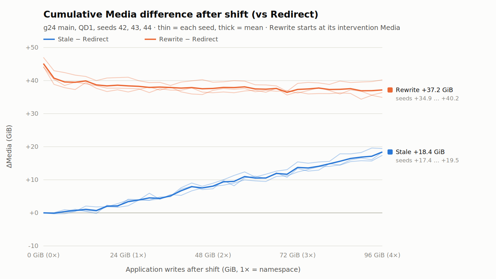
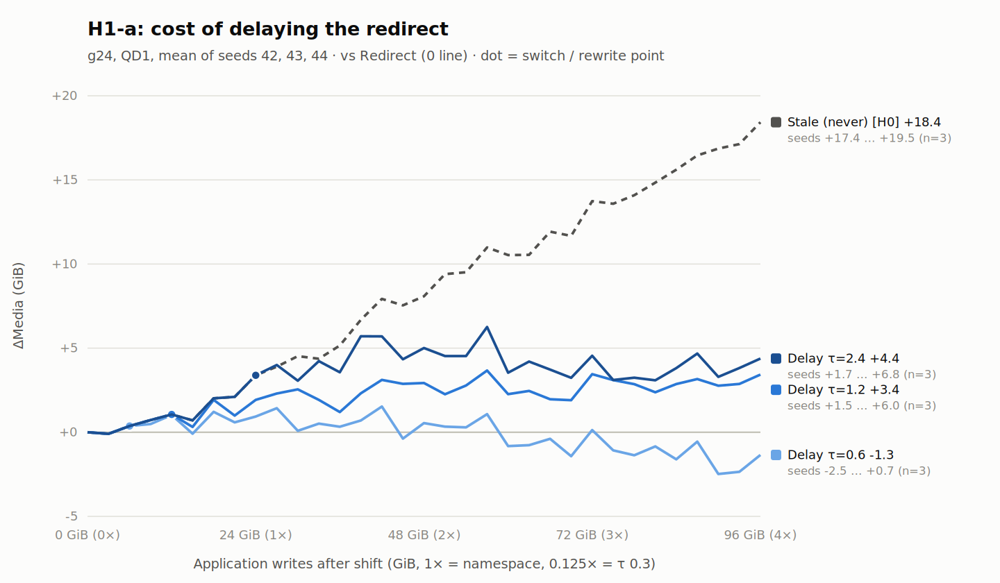
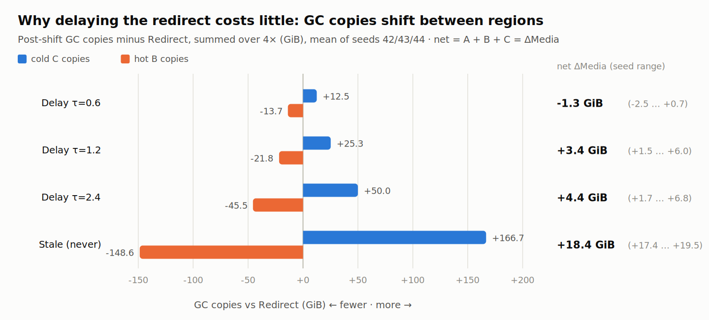
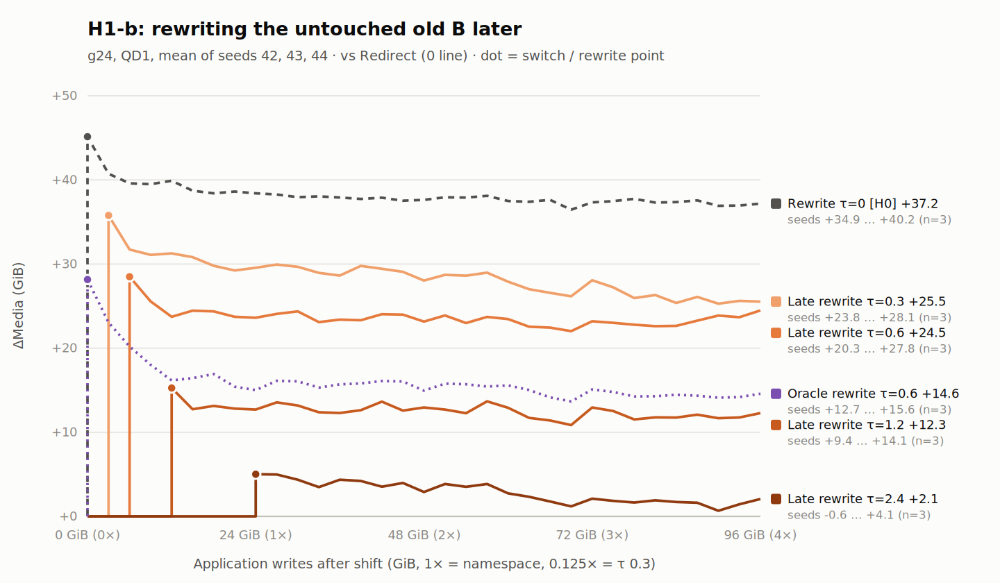
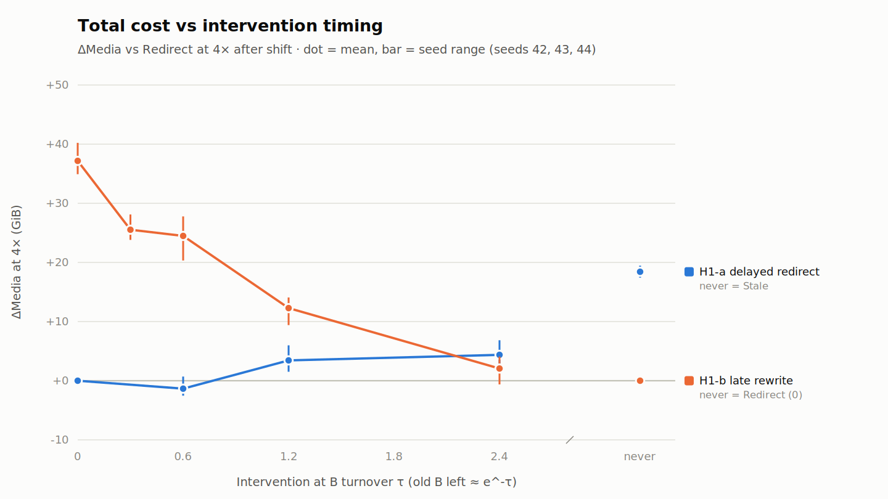

# H0 v3 · H1 v2 결과 보고서

## Stale FDP placement의 유지 비용, 수정 비용, 그리고 개입 시점

작성일: 2026-10-17  
분석 범위: H0 v3 본 실험(9 run) + H1 v2 본 실험(24 run) + 검증 run  
조건: FEMU FDP, g24 scaled-down WARP 기반 설정, QD1 결정적 실행, seed 42/43/44

---

## 요약

workload의 hot 영역이 바뀐 뒤(shift) 기존 FDP placement를 유지하는 비용과, placement를 고치는 개입의 비용·시점을 같은 장치·같은 요청열에서 비교했다. 개입은 두 가지다.

- **Redirect:** 앞으로 쓰는 B만 새 PID로 보낸다. 데이터 이동은 없다.
- **Rewrite:** 이미 쓰인 B를 실제로 읽어서 새 PID로 다시 쓴다.

비교의 기준은 즉시 Redirect다. 모든 수치는 shift 후 application write 4×(96 GiB) 시점의 누적 Media(NAND user + GC copy) 차이다.

1. **Stale 유지 비용은 있다(H0-A 지지).** Stale은 Redirect보다 +18.4 GiB(seed 범위 17.4–19.5)가 더 들었다. 이 비용은 1×마다 약 4.9 GiB씩 끝까지 계속 쌓인다.
2. **Rewrite 비용도 있고, 회수되지 않는다(H0-B 지지).** B 8 GiB를 다시 쓰는 데 Media 45.1 GiB가 들었다. 이후 절감은 8.0 GiB여서 4× 안에 회수되지 않았다.
3. **Redirect를 늦추는 손해는 작다(H1-a).** τ 0.6 / 1.2 / 2.4(shift 후 0.25× / 0.5× / 1×)까지 늦춰도 손해는 −1.4 / +3.4 / +4.4 GiB였다. 1× 늦춰도 Stale 비용의 약 3/4은 피한다.
   - Redirect하면 비용 누적은 멈춘다.
   - 전환 뒤 잔여 순비용은 0에 가깝고, 약 ±3 GiB의 궤적 차이 범위 안이다.
4. **늦게 rewrite해도 Redirect보다 나은 시점은 없다(H1-b).** 덮어써지지 않은 old B만 늦게 옮기면 총비용은 +37.2(τ 0)에서 +2.1 GiB(τ 2.4)까지 줄었다. 하지만 어느 시점도 Redirect보다 확실히 낫지 않았다.
5. **늦은 rewrite가 싼 이유는 옮기는 양이 줄기 때문뿐이다.** 같은 블록을 옮기면 늦을수록 손해다.
   - oracle 대조군(τ 0.6과 같은 블록을 shift 때 이동)으로 나눠 보면, 양 효과는 −22.6 GiB, 시점 효과는 +9.9 GiB였다. 시점 효과는 세 seed 모두 양수였다.
   - migration 이득은 shift 직후에 몰려 있어서, 기다리면 그 이득을 잃는다.
6. **메커니즘은 수명이 섞이는 문제다.** Stale은 cold C의 GC 복사를 +167 GiB 늘리고, hot B 복사를 −149 GiB 줄인다. 순손실은 그 차이(C 증가분의 약 11%)다.
   - Rewrite 비용의 대부분도 RUH1에 같이 있던 C를 다시 복사하는 데서 나온다.
   - 순효과가 큰 두 흐름의 작은 차이이기 때문에, 정책 간 차이 중 ±3 GiB 정도는 GC 궤적 차이와 구분하기 어렵다.

**판정.**
- H0-A·H0-B는 지지된다.
- 이 설정에서 최선은 **즉시 Redirect + 재기록 없음**이다. Redirect는 늦어져도 손해가 작고, migration은 어느 시점에도 회수되지 않는다.
- 남는 질문은 "개입에 비용이 따르는 조건(쓸 수 있는 RUH가 부족하거나 잘못 놓인 데이터가 오래 남는 경우)에서도 이 결론이 유지되는가"다. 이것이 H2의 출발점이다([H2 실험계획 초안](H2_실험계획_초안.md)).

---

## 1. 연구 질문과 이번 범위

연구 전체 질문:

> Non-stationary workload에서 기존 FDP placement가 workload 변화 이후 stale해졌을 때, 이를 그대로 유지하는 비용과 placement를 수정하는 intervention 비용 사이에 실제 trade-off가 존재하는가?

| 단계 | 질문 | 이번 보고서 |
|---|---|---|
| H0-A | Stale placement를 유지하면 Media 손해가 있는가? | v3 |
| H0-B | 잘못된 placement를 고치는 rewrite 자체에 비용이 있는가? | v3 |
| H1-a | Redirect를 늦추면 비용이 어떻게 늘어나는가? | v2 |
| H1-b | Redirect는 즉시 하고, 덮어써지지 않은 old B만 나중에 rewrite하면 즉시 rewrite보다 나은가? | v2 |
| H2 | Host 통계로 개입 여부와 시점을 결정할 수 있는가? | 계획만 |

**이전 버전과의 관계.** H0 v2와 H1 v1의 요청 생성기에는 난수 결함이 있었다(chunk마다 같은 LBA 집합이 반복됨). 이번 보고서는 결함을 고친 생성기(2026-10-09)로 다시 수행한 H0 v3와 H1 v2만 다룬다. 이전 결과는 workload 해석에 쓰지 않는다.

## 2. 실험 설정

### 2.1 장치 (scaled-down WARP 기반 FEMU 설정)

| 항목 | 설정 |
|---|---|
| Exposed / physical | 24 GiB (196,608 × 128 KiB) / 212 RU × 128 MiB = 26.5 GiB, OP 10.42% |
| NAND 구조 | 8 ch × 8 LUN, page 4 KiB, RU 32,768 pages |
| FDP | RG 1, RUH 3, 모두 PI (`fdp.isolation_mode=0`) |
| GC | Greedy, background 90% / foreground 99%(정수 올림 → free 3 RU), **lazy GC 5%**(WARP) |
| 미포함 | WARP block remapping(공개 구현에 없음), write buffer |
| NAND latency | 끔. latency를 켠 run과 FTL 결과(hash·counter·GC trace)가 같음을 확인했다 |
| VM | KVM 4 vCPU / 2 GiB, Ubuntu 24.04.5 guest, io_uring NVMe passthrough 생성기 |

lazy 5% 규칙 때문에 background GC는 victim의 valid 비율이 5% 이하일 때만 동작한다. 실제로 33개 본 실험 run에서 GC 332,343회가 **모두 forced GC**였다. victim의 평균 valid 비율은 약 0.87이고, shift 전 마지막 1× WAF는 7.43이다. 실제 SSD보다 WAF가 높은 조건이므로 절대값이 아니라 같은 조건 안의 상대 비교로 해석한다.

### 2.2 Workload

| 항목 | 설정 |
|---|---|
| 영역 A / B / C | 각 8 GiB (namespace를 3등분) |
| 준비 | 128 KiB fill 1회 → 4 KiB random write 3×(72 GiB), A/B/C = **80/10/10%**, 12 chunk |
| Shift 이후 | 4 KiB random write 4×(96 GiB), A/B/C = **10/80/10%**, 32 chunk(각 3 GiB) |
| 초기 PID | A→PID0, B→PID1, C→PID1. Redirect는 B→PID2 |
| 영역 안 분포 | uniform random. 덮어써지지 않은 old B는 e^-τ를 따른다(τ 0.6 / 1.2 / 2.4에서 54.9 / 30.1 / 9.1%) |
| 실행 | QD1, 속도 제한 없음, seed 42/43/44. chunk seed는 정책과 무관하게 고정 |

**B turnover τ_B** = shift 이후 B에 들어간 쓰기 / B 크기(8 GiB). post chunk 하나가 τ 0.3이다. 1×(24 GiB)는 τ 2.4, 4×는 τ 9.6이다.

### 2.3 지표

```text
Media = NAND user pages + GC copy pages            (c0 counter, chunk 경계 flush마다)
ΔMedia(x) = 정책의 누적 Media(x) − Redirect의 누적 Media(x)
x = shift 이후 application write (rewrite write는 x에 넣지 않음)
rewrite의 Media는 그 rewrite가 실행된 chunk 경계에 더함
```

- 모든 정책에서 application write량이 같으므로 ΔMedia는 GC copy 차이와 rewrite write를 더한 값이다.
- 주지표는 4× 시점 ΔMedia다. 1×·2× 시점 값과, 2×–4× 구간의 기울기(1×당 ΔMedia 증가량)를 함께 보고한다.

## 3. 비교 신뢰성

QD1에서 FEMU의 FTL은 결정적으로 동작한다. 같은 입력이면 모든 snapshot의 FTL state hash, c0 counter, GC trace가 bit 단위로 같다(QD1 A/A로 확인). 이 성질을 이용해 정책 간 차이가 개입에서만 생겼음을 다음과 같이 확인했다.

| 검증 | 내용 | 결과 |
|---|---|---|
| 같은 출발 상태 | H0 v3에서 seed마다 세 정책의 shift 직전 FTL state hash 비교 | 모두 일치 |
| 개입 전 동등성 | H1 run마다 개입 직전 snapshot까지 FTL state hash와 c0 counter를 H0 run과 비교. delay는 Stale, late·oracle은 Redirect와 비교 | 24/24 일치 |
| 같은 요청열 | fill·pre·post 모든 chunk의 LBA hash와 요청 수 | 24/24 일치 |
| rewrite 대상 | FEMU trace(H1_BMAP)로 B 블록마다 소속 RUH를 집계. late: 개입 직전 PID1의 B 수 = 생성기 대상 수, rewrite 뒤 0. oracle: 대상 수와 일치, chunk c 뒤 0 | 15/15 일치 |
| τ=0 끝점 | H1 코드로 H0 정책 `rewrite`를 다시 실행해 H0 Rewrite run과 비교 | 19개 snapshot 모두 일치 |
| 환경 재현 | 재부팅 후 환경 확인 run이 기준 run과 9개 snapshot 모두 일치 | 통과 |
| 중단 run | 강제 종료로 끊긴 run을 다시 돌려, 끊기기 전 38개 snapshot 비교 | 모두 일치 |

- **해석 단위.** 같은 seed 안에서는 측정 잡음이 없다. 다만 개입처럼 FTL 상태가 조금만 달라져도 이후 GC 궤적이 크게 갈린다.
- **궤적 차이의 크기.** 이론상 차이가 거의 없어야 할 경우들로 가늠했다. delay τ 0.6의 Redirect 대비 값(−2.5…+0.7), H1-a의 전환 뒤 순비용(−3.2…+5.5)이 그 예다. 4× 시점에서 대략 **±3 GiB**다.
- 그래서 이보다 작은 정책 간 차이는 효과로 해석하지 않는다. seed 3개의 평균과 범위만 보고하고 통계적 유의성은 주장하지 않는다.

## 4. H0 결과: 유지 비용과 수정 비용

| 지표 (seed 평균, 범위) | 값 |
|---|---|
| Shift 직전 1× WAF | 7.43 (7.37–7.48) |
| Post Media/App: Stale / Redirect / Rewrite(개입 제외) | 7.763 / 7.571 / 7.488 |
| **Stale − Redirect** (4×) | **+18.4 GiB** (+17.4…+19.5), Redirect Media의 +2.5% |
| Rewrite 개입 비용 (B 8 GiB 재기록) | Media 45.1 GiB (44.1–47.0), 생성기 시간 176 s |
| Rewrite 이후 절감 | 8.0 GiB (6.8–9.2) |
| **Rewrite − Redirect** (4×) | **+37.2 GiB** (+34.9…+40.2), 세 seed 모두 미회수 |



- **Stale 비용은 계속 쌓인다.** 구간별 증가량은 0→1× +3.4, 1→2× +4.7, 2→3× +5.7, 3→4× +4.7 GiB다. 2×–4× 기울기는 1×당 +4.86 GiB(4.36–5.24)다.
- **Rewrite 절감은 초기에 몰린다.** 0→0.25× 구간에서 −5.5 GiB가 줄고, 1× 이후에는 거의 0이다. 2×–4× 기울기는 −0.36 GiB/×다. 이 속도로는 남은 37 GiB를 회수하는 데 100× 이상이 걸린다.

**판정:** H0-A 지지(세 seed 모두 양수, seed 범위가 효과보다 훨씬 작음). H0-B 지지(rewrite 비용이 측정됐고 회수되지 않음).

## 5. H1-a 결과: Redirect를 늦추면

정책 delay(τ): post chunk 1..c 동안 B를 PID1에 쓰고, 그 뒤 PID2로 전환한다. 전환 직전까지는 Stale과 bit 단위로 같다.

| τ (전환 chunk) | s42 | s43 | s44 | 평균 | Stale 격차 대비 | 전환 시점 ΔMedia |
|---|---:|---:|---:|---:|---:|---:|
| 0 (Redirect) | 0 | 0 | 0 | 0 | 0% | – |
| 0.6 (2) | −2.2 | +0.7 | −2.5 | **−1.4** | −8% | +0.4 |
| 1.2 (4) | +1.5 | +6.0 | +2.8 | **+3.4** | 18% | +1.1 |
| 2.4 (8) | +1.7 | +6.8 | +4.6 | **+4.4** | 23% | +3.4 |
| never (Stale) | +17.4 | +19.5 | +18.4 | +18.4 | 100% | – |



- **순서는 세 seed 모두 같다.** τ 0.6 < 1.2 < 2.4 순서가 seed마다 성립한다. 전환 시점까지의 비용(Stale과 같은 구간)도 τ와 함께 커진다.
- **Redirect하면 누적이 멈춘다.** 2×–4× 기울기는 delay 세 수준 모두 1×당 −1.3…+0.2 GiB로 0 근처다. Stale은 +4.9다(표 A).
- **잔여 순비용은 0 근처다.** 전환 뒤 생긴 ΔMedia는 평균 −1.7 / +2.4 / +1.0 GiB로 궤적 차이 범위 안이다.
  - 전환 시점에 B의 유효 데이터는 지연 중의 새 쓰기까지 포함해 100% PID1에 있다.
  - 전환 뒤 PID1에 남은 B는 e^-(τ−τ전환)으로 줄어, 약 1.75× 뒤에는 2% 아래로 내려간다(표 C).
- **τ 0.6의 음수(−1.4)는 효과로 보지 않는다.** "Redirect보다 낫다"는 근거가 아니라 궤적 차이로 해석한다.

**메커니즘.** 아래 그림은 shift 이후 GC copy를 영역별로 Redirect와 비교한 것이다.



- B를 C와 같은 RUH에 두면, cold C가 hot B의 GC에 끌려 반복 복사된다(C +). 대신 hot B는 C와 섞인 RU에서 무효화되어 덜 복사된다(B −).
- 순손실은 두 흐름의 차이로, Stale에서 C 증가분의 약 11%(18.4 / 166.7)다.
- delay에서 C 증가분은 전환 뒤에도 계속 쌓인다. τ 2.4 기준으로 전환 시점 +22.6 → 4× +50.0 GiB다. 하지만 B 감소분(−19.4 → −45.5)이 거의 같은 양으로 상쇄한다.
- 순효과가 큰 두 흐름의 작은 차이라서, 수준 간 차이가 수 GiB씩 흔들린다.

**판정:**
- Redirect는 즉시 하는 것이 가장 좋다. 하지만 1×(τ 2.4) 이내의 지연은 Stale 비용의 23% 이하만 더한다.
- Redirect 이후 잔여 비용이 따로 있다는 근거는 없다(±3 GiB 이내).

## 6. H1-b 결과: 덮어써지지 않은 old B만 늦게 rewrite하면

정책 late_rewrite(τ):
- B는 shift부터 PID2로 쓴다.
- chunk c가 끝나면, shift 때 있던 old B 중 chunk 1..c에서 덮어써지지 않은 블록만 PID2로 다시 쓴다.
- 대상은 host가 자기 요청을 재생해서 구한다. 실제 host도 구현할 수 있는 정보다.

진단용 oracle(τ 0.6)은 late τ 0.6과 같은 블록을 shift 시점에 옮긴다. 미래 요청을 알아야 하므로 실제 정책은 아니다.

| τ | 옮긴 양 | s42 | s43 | s44 | 평균 ΔMedia |
|---|---|---:|---:|---:|---:|
| 0 (H0 Rewrite) | 8.0 GiB (100%) | +34.9 | +40.2 | +36.4 | **+37.2** |
| 0.3 | 5.9 GiB (74%) | +23.8 | +28.1 | +24.6 | **+25.5** |
| 0.6 | 4.4 GiB (55%) | +20.3 | +25.3 | +27.8 | **+24.5** |
| 1.2 | 2.4 GiB (30%) | +9.4 | +14.1 | +13.4 | **+12.3** |
| 2.4 | 0.7 GiB (9%) | +2.8 | −0.6 | +4.1 | **+2.1** |
| never (Redirect) | 0 | 0 | 0 | 0 | 0 |
| oracle 0.6 (진단용) | 4.4 GiB | +15.4 | +15.6 | +12.7 | **+14.6** |





- **늦출수록 총비용은 줄지만, 어느 시점도 Redirect보다 확실히 낫지 않다.**
  - τ 2.4 s43의 −0.6(post_20에 회수)은 궤적 차이 범위 안이다.
  - seed 44에서는 τ 0.3이 τ 0.6보다 3.1 GiB 낮았다. 이 차이도 같은 범위 안이다.
- **결론은 관측 구간에 따라 바뀌지 않는다.** 1×·2×·4× 어느 시점에서도 Redirect가 가장 낮다(표 A).

**rewrite의 경제성.** 순비용은 개입 비용에서 개입 뒤 절감을 뺀 값과 같다.

| 정책 | 옮긴 양 | 개입 Media | 옮긴 1 GiB당 비용 | 개입 뒤 절감 | 옮긴 1 GiB당 절감 | 순 ΔMedia |
|---|---:|---:|---:|---:|---:|---:|
| Rewrite τ0 | 8.00 | 45.1 | 5.64 | 8.0 | 0.99 | +37.2 |
| late τ0.3 | 5.93 | 35.8 | 6.04 | 10.3 | 1.73 | +25.5 |
| late τ0.6 | 4.39 | 28.5 | 6.49 | 4.0 | 0.91 | +24.5 |
| late τ1.2 | 2.41 | 15.3 | 6.33 | 3.0 | 1.24 | +12.3 |
| late τ2.4 | 0.73 | 5.0 | 6.90 | 2.9 | 4.05* | +2.1 |
| oracle τ0.6 | 4.39 | 28.2 | 6.41 | 13.6 | 3.09 | +14.6 |

\* 절감 2.9 GiB 자체가 궤적 차이 범위 안이므로, 1 GiB당 값은 신뢰하기 어렵다.

- **비용 쪽:** 1 GiB를 옮기는 데 Media 5.6–6.9 GiB가 든다. 늦을수록 조금 비싸진다.
  - 개입 중 GC victim은 거의 모두 RUH1이고, 복사된 데이터의 65–86%가 C다(표 B).
  - 이유: old B를 다시 쓰면 RUH1의 RU가 가장 비게 되고, forced GC가 그 RU를 고르면서 같이 있던 C를 복사한다.
- **이득 쪽:** 옮긴 1 GiB당 절감은 가장 좋은 oracle에서도 3.1 GiB다. 비용의 절반에 못 미친다.

**양 효과와 시점 효과 (τ 0.6).**

| | s42 | s43 | s44 | 평균 |
|---|---:|---:|---:|---:|
| 양 효과: oracle − Rewrite(τ0) | −19.5 | −24.6 | −23.7 | **−22.6** |
| 시점 효과: late − oracle | +4.9 | +9.7 | +15.0 | **+9.9** |
| 합계: late − Rewrite(τ0) | −14.6 | −14.9 | −8.6 | −12.7 |

- **같은 블록을 옮기는 비용은 시점과 무관하게 비슷하다.** rewrite 구간의 GC copy는 oracle 23.8 GiB, late 24.1 GiB다.
- **시점 효과는 기다리는 동안 생긴다.**
  - 기다리는 동안(첫 0.25×), 아직 PID1에 남은 블록이 RUH1의 GC에 반복 복사된다. 이 추가 GC가 약 7.8 GiB다.
  - 그 뒤 4×까지 차이는 +2.4 GiB만 더 늘어난다. late와 oracle의 누적 GC 차이는 chunk 2에서 −15.9, rewrite 직후인 chunk 3에서 +7.6, 4×에서 +10.0 GiB였다.
- H0에서 rewrite 이득이 첫 0.25×에 몰렸던 것과 같은 현상이다.

**판정:**
- "기다렸다 옮기기"에는 Redirect만 하는 것보다 나은 시점이 없다.
- 늦은 rewrite가 즉시 rewrite보다 싼 이유는 옮기는 양이 자연 overwrite로 줄었기 때문뿐이다. 같은 블록이라면 늦을수록 손해다.
- 굳이 옮긴다면 shift 직후, 살아남을 블록만 옮기는 것이 가장 유리하다. 그래도 4× 안에는 손해다.

## 7. 종합

| 판단 항목 | 근거 | 판정 |
|---|---|---|
| Stale 유지 비용이 있는가? | +18.4 GiB, 1×마다 4.9 GiB씩 계속 증가 | 확인 (H0-A) |
| 수정(rewrite) 자체에 비용이 있는가? | 옮긴 1 GiB당 Media 5.6–6.9 GiB | 확인 (H0-B) |
| Redirect 시점이 중요한가? | 늦출수록 손해가 커지지만 1× 이내는 Stale의 23% 이하 | 중요하지만 손해는 작음 |
| Redirect 뒤 잔여 비용이 있는가? | 순비용 평균 0.5 GiB, ±3 GiB 이내 | 근거 없음 |
| migration에 유리한 시점이 있는가? | 모든 τ에서 Redirect 이상. 시점 효과 +9.9 GiB | 이 조건에서는 없음 |
| 최선의 정책 | 즉시 Redirect + 재기록 없음 | – |

이 조건에서 앞의 trade-off는 **개입 종류에 따라 갈린다.**
- **Redirect:** 데이터를 옮기지 않으므로 거의 비용이 없고, 빨리 할수록 좋다.
- **Migration:** 비용(장치 WAF 수준의 증폭)이 이득(잘못 놓인 데이터가 자연히 사라질 때까지 GC에 끌려 복사되는 양)보다 크다.

이득이 작은 이유는 잘못 놓인 old B가 이제 hot이어서 금방 자연 overwrite되기 때문이다. 평균 잔여 수명은 1 turnover(약 0.42×)다.

## 8. 해석 범위와 한계

1. **QD1 결정적 실행.** 메커니즘을 깨끗이 보기 위한 조건이다.
   - QD32에서는 명령 순서 때문에 같은 seed끼리도 결과가 크게 달랐다. pilot에서 A/A 차이가 정책 효과보다 컸다.
   - 그래서 QD32 검증은 비교할 정책을 정한 뒤, 반복 수를 먼저 정하고 진행한다.
2. **한 번의 지속적인 step shift.** 영역 안 uniform random, 같은 크기의 세 영역 조건이다. 일시적 변화, 점진적 변화, 영역 안 skew는 다루지 않았다.
3. **빈 RUH가 있는 조건.** Redirect는 비어 있던 PID2를 쓴다. 쓸 수 있는 RUH가 부족해 다른 데이터가 있는 RUH를 같이 써야 하면, redirect에도 잔여 비용이 생길 수 있다. 이번에는 다루지 않았다.
4. **4× 관측 구간.** 다만 2×–4× 기울기가 Stale을 빼면 모두 0 근처라, 구간을 늘려도 순서가 바뀔 근거는 없다.
5. **축소된 WARP 기반 설정.** OP 10.42%, lazy GC 5%(모든 GC가 forced), RU 128 MiB, block remapping 없음이라 WAF가 높다(약 7.5). 절대 수치가 아니라 같은 조건 안의 상대 비교다.
6. **seed 3개.** 궤적 차이 약 ±3 GiB보다 작은 차이는 해석하지 않는다. 통계적 유의성은 평가하지 않았다.
7. **측정 범위.** Media는 FEMU 카운터 기준이다. latency 에뮬레이션을 껐으므로 latency·처리량은 측정하지 않았다. rewrite 중 application 정지 시간은 생성기 실행 시간으로만 기록했다(τ0 176 s, late τ0.6 110 s, oracle 125 s).

## 9. H2로 이어지는 시사점

이 조건에서는 결정이 단순하다. **변화를 감지하면 바로 Redirect하고, migration은 하지 않는다.** H2의 원래 질문("host 통계로 개입 시점을 정할 수 있는가")을 이 조건에서 다시 실험하면 답이 이미 정해져 있다.

H1의 결과를 하나의 비용 모델로 정리할 수 있다.
- 개입의 가치 = 피한 stale 비용 − 개입이 남기는 잔여 비용 − 일회성 이동 비용
- 잔여 비용은 남겨진 데이터의 양 × 그 데이터가 자연히 사라지기까지의 시간 × 섞임에 따른 GC 손실률로 정해진다.

이 모델로 보면, 개입에 실제 비용이 생기는 조건에서 결정이 갈릴 것으로 예상된다.
- RUH가 부족해 redirect가 다른 데이터가 있는 RUH를 써야 하는 경우
- 잘못 놓인 데이터가 cold라서 오래 남는 경우

H2는 이 조건들에서 모델의 예측을 검증하고, host가 관측할 수 있는 통계만으로 올바른 결정을 내리는 규칙을 평가하는 방향으로 계획했다 → [H2 실험계획 초안](H2_실험계획_초안.md).

---

## 부록 A. 관측 구간별 ΔMedia와 후반 기울기

seed 평균(최소..최대), GiB. 기울기는 2×–4× 구간 최소제곱으로 구한 1×당 ΔMedia 변화량이다.

| 정책 | 1× | 2× | 4× | 2×–4× 기울기 |
|---|---|---|---|---|
| Stale | +3.4 (+2.1..+4.1) | +8.1 (+7.3..+8.9) | +18.4 (+17.4..+19.5) | +4.86 (+4.36..+5.24) |
| Rewrite τ0 | +38.4 (+36.6..+41.0) | +37.6 (+36.3..+39.5) | +37.2 (+34.9..+40.2) | −0.36 (−0.81..+0.22) |
| delay τ0.6 | +0.9 (+0.2..+2.0) | +0.5 (−1.5..+1.6) | −1.3 (−2.5..+0.7) | −1.25 (−2.77..−0.21) |
| delay τ1.2 | +1.9 (+1.1..+2.8) | +2.9 (+1.9..+4.8) | +3.4 (+1.5..+6.0) | +0.21 (−0.75..+1.19) |
| delay τ2.4 | +3.4 (+2.1..+4.1) | +5.0 (+3.7..+7.2) | +4.4 (+1.7..+6.8) | −0.56 (−1.54..+0.11) |
| late τ0.3 | +29.6 (+28.2..+30.9) | +28.0 (+26.5..+29.4) | +25.5 (+23.8..+28.1) | −1.73 (−2.73..−0.99) |
| late τ0.6 | +23.6 (+21.8..+24.6) | +23.2 (+20.1..+24.8) | +24.5 (+20.3..+27.8) | +0.21 (−0.42..+1.17) |
| late τ1.2 | +12.7 (+11.6..+14.8) | +12.9 (+10.3..+16.0) | +12.3 (+9.4..+14.1) | −0.51 (−0.91..−0.12) |
| late τ2.4 | +5.0 (+4.7..+5.4) | +2.9 (+2.0..+3.6) | +2.1 (−0.6..+4.1) | −1.11 (−2.04..−0.23) |
| oracle τ0.6 | +15.0 (+13.5..+16.1) | +15.0 (+12.9..+17.4) | +14.6 (+12.7..+15.6) | −0.68 (−0.96..−0.42) |

## 부록 B. GC copy 분해

**Shift 이후 GC copy의 Redirect 대비 차이.** 단위 GiB이며, rewrite 구간은 제외했다. victim 수는 RUH0/1/2 순이다.

| 정책 | A | B | C | victim valid 비율 | victim RUH0/1/2 |
|---|---:|---:|---:|---:|---|
| Redirect (절대값) | 66.8 | 463.9 | 100.0 | 0.868 | 612 / 1130 / 4072 |
| Stale | +0.3 | −148.6 | +166.7 | 0.871 | 614 / 5347 / 0 |
| delay τ0.6 | −0.2 | −13.7 | +12.5 | 0.868 | 611 / 1423 / 3769 |
| delay τ1.2 | −0.0 | −21.8 | +25.3 | 0.869 | 611 / 1721 / 3509 |
| delay τ2.4 | −0.1 | −45.5 | +50.0 | 0.869 | 611 / 2312 / 2925 |
| Rewrite τ0 | −0.7 | +24.0 | −31.3 | 0.866 | 606 / 632 / 4513 |
| late τ0.3 | −0.3 | +15.3 | −25.3 | 0.866 | 609 / 757 / 4366 |
| late τ0.6 | −0.3 | +16.1 | −19.9 | 0.867 | 609 / 853 / 4320 |
| late τ1.2 | +0.3 | +8.7 | −12.0 | 0.867 | 615 / 978 / 4197 |
| late τ2.4 | +0.1 | +0.3 | −3.3 | 0.867 | 612 / 1090 / 4088 |
| oracle τ0.6 | −1.6 | +4.9 | −16.9 | 0.865 | 598 / 809 / 4298 |

**Rewrite 구간의 GC copy.** 단위 GiB.

| 정책 | 옮긴 양 | A | B | C | victim valid 비율 | Media / 옮긴 GiB | victim RUH0/1/2 |
|---|---:|---:|---:|---:|---:|---:|---|
| Rewrite τ0 | 8.00 | 0.7 | 12.1 | 24.3 | 0.825 | 5.64 | 6 / 354 / 0 |
| late τ0.3 | 5.93 | 0.1 | 8.2 | 21.5 | 0.837 | 6.04 | 1 / 284 / 0 |
| late τ0.6 | 4.39 | 0.0 | 5.6 | 18.5 | 0.845 | 6.49 | 0 / 226 / 1 |
| late τ1.2 | 2.41 | 0.0 | 2.1 | 10.7 | 0.840 | 6.33 | 0 / 119 / 3 |
| late τ2.4 | 0.73 | 0.1 | 0.5 | 3.7 | 0.858 | 6.90 | 1 / 36 / 3 |
| oracle τ0.6 | 4.39 | 0.8 | 9.6 | 13.3 | 0.845 | 6.41 | 7 / 218 / 0 |

- rewrite는 C 복사를 줄이지만(−31.3 GiB), B 복사를 늘린다(+24.0 GiB).
  - old B가 shift 때 한꺼번에 사라지므로, RUH1이 C를 반복해서 다시 압축할 필요가 줄어든다(C 감소).
  - 대신 RUH2가 처음부터 B 전체를 유효 데이터로 갖게 되어, B의 GC 복사가 늘어난다(추정).

## 부록 C. 전환 뒤 PID1에 남은 B (H1_BMAP)

chunk c가 끝난 뒤 B 중 PID1 RUH에 있는 비율이다(seed 평균).

| 정책 | 1 | 2 | 4 | 8 | 12 | 16 | 24 | 32 |
|---|---:|---:|---:|---:|---:|---:|---:|---:|
| delay τ0.6 | 1.000 | 1.000 | 0.549 | 0.165 | 0.050 | 0.015 | 0.001 | 0.000 |
| delay τ1.2 | 1.000 | 1.000 | 1.000 | 0.301 | 0.091 | 0.027 | 0.002 | 0.000 |
| delay τ2.4 | 1.000 | 1.000 | 1.000 | 1.000 | 0.301 | 0.091 | 0.008 | 0.001 |
| late τ0.6 | 0.741 | 0.549 | 0 | 0 | 0 | 0 | 0 | 0 |
| oracle τ0.6 | 0.192 | 0 | 0 | 0 | 0 | 0 | 0 | 0 |

delay에서는 전환 뒤 e^-(τ−τ전환)을 정확히 따른다. 예를 들어 0.549 = e^-0.6, 0.165 = e^-1.8이다. late와 oracle에서는 rewrite 뒤 0이다.

## 부록 D. 재현 정보

| 항목 | 위치 |
|---|---|
| 설계 근거와 결정 기록 | [GC 기준 메모](GC_기준_메모.md), [H1 v2 실험계획](H1_v2_실험계획.md) |
| H0 v3 run | `exp/H0/v3/runs/main_g24_{stale,redirect,rewrite}_s{42,43,44}_01` |
| H1 v2 run | `exp/H1/v2/runs/h1a_g24_delay_t*`, `h1b_g24_laterw_t*`, `h1b_g24_oracle_t0.6_*` |
| 검증 run | `equiv_g24_rewrite_s42_emberygram`, `verify_ref_*`, `verify_g24_*`, `smoke_g24_*` |
| 집계 | `exp/H0/v3/analysis/main_all.*`, `exp/H1/v2/analysis/h1_all.*` |
| 메커니즘 표 | `exp/H1/v2/analysis/h1_mechanism.{txt,json}` (`h1_mechanism.py`) |
| GC 흐름 그림 | `exp/H1/v2/analysis/h1_gcflow.{svg,png}` (`h1_gcflow_plot.py`) |
| 캠페인 로그 | `exp/H0/v3/_ops/campaign_main.log`, `exp/H1/v2/_ops/campaign.log` |
| QEMU SHA256 | H0 v3: `6480b3be…`, H1 v2: `636a5585…`. 차이는 읽기 전용 FDP trace뿐이다(검증: 개입 전 동등성, τ=0 끝점) |
| commit | H0 v3 `1921a932a`, H1 v2 준비 `667f56d0a`. H1 결과는 이 보고서와 함께 commit 예정 |
